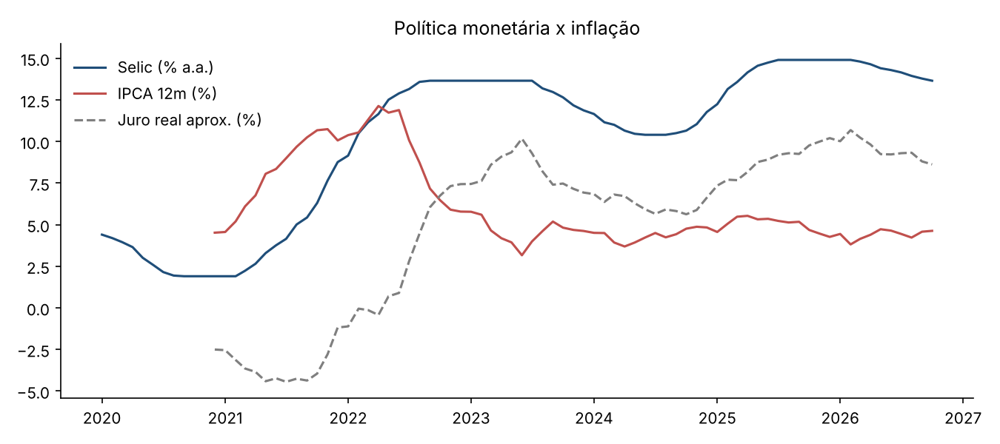
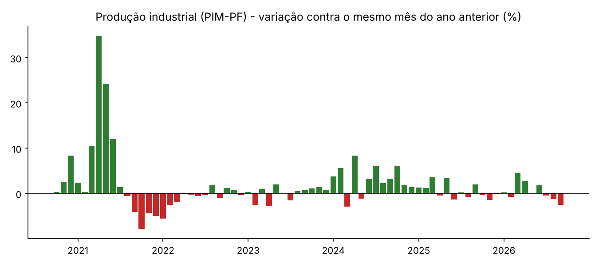

# 📈 Conjuntura Econômica Brasil

[](https://github.com/rafacampanha/conjuntura-economica-br/actions/workflows/testes.yml)

Pipeline em Python que coleta indicadores macroeconômicos em **APIs públicas** (Banco Central e IBGE), trata as séries e entrega uma base pronta para um **painel no Power BI**: inflação, juros, câmbio e produção industrial.

> Projeto pessoal inspirado no tipo de painel de conjuntura que desenvolvo no trabalho. Aqui ele é refeito do zero, só com dados públicos.




## O que ele faz

| Etapa | Arquivo | Detalhe |
|---|---|---|
| Coleta | `src/coleta.py` | API SGS do BCB (Selic, IPCA, INPC, dólar PTAX, IBC-Br) e API de agregados do IBGE (PIM-PF) |
| Tratamento | `src/indicadores.py` | Inflação acumulada em 12 meses, variação MoM/YoY, mensalização de séries diárias, juro real |
| Saída | `data/` | Um CSV por série + `conjuntura.db` (SQLite) para ligar direto no Power BI |
| Visualização | `src/graficos.py` e `powerbi/medidas_dax.md` | Gráficos do README e as medidas DAX usadas no painel |
| Testes | `tests/` | `pytest` com fixtures no formato real das APIs |

## Indicadores

| Indicador | Fonte | Código |
|---|---|---|
| Selic (% a.a., mensal) | BCB/SGS | 4189 |
| IPCA – variação mensal | BCB/SGS | 433 |
| INPC – variação mensal | BCB/SGS | 188 |
| Dólar PTAX venda | BCB/SGS | 1 |
| IBC-Br dessazonalizado | BCB/SGS | 24364 |
| Produção Industrial (PIM-PF), indústria geral | IBGE/SIDRA | tabela 8888 |

## Como rodar

```bash
python -m venv .venv && source .venv/bin/activate   # Windows: .venv\Scripts\activate
pip install -r requirements.txt
python -m src.coleta        # baixa os dados para data/
python -m src.graficos      # gera data/painel_mensal.csv e os gráficos em img/
pytest                      # roda os testes
```

## No Power BI

1. **Obter dados → Pasta** (ou SQLite via ODBC) apontando para `data/`.
2. Criar uma tabela `Calendario` e relacionar por `data`.
3. Copiar as medidas de [`powerbi/medidas_dax.md`](powerbi/medidas_dax.md).

## Tecnologias

Python · pandas · requests · matplotlib · SQLite · pytest · Power BI / DAX
